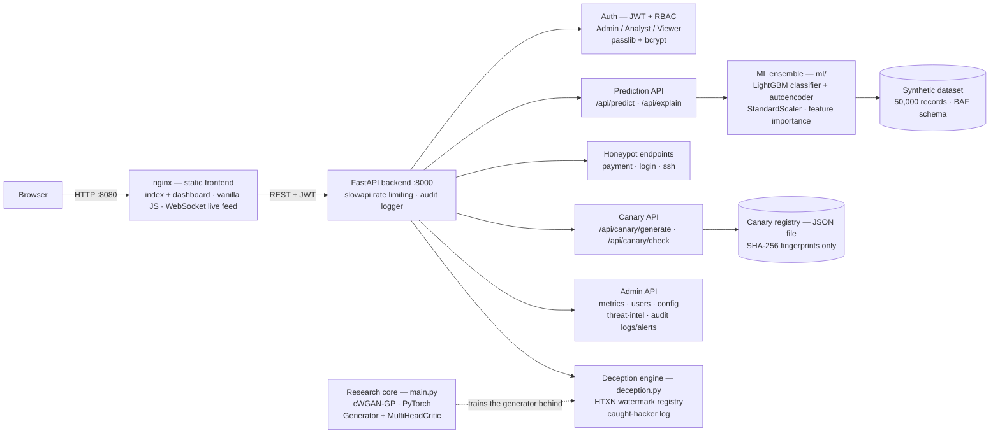

<div align="center">
  <h1>🧅 Deceptive-Net</h1>
  <p><b>A Generative AI-Driven Financial Fraud Detection & Cyber Deception Framework</b></p>
</div>


[](https://github.com/Manoj-2424150118/Deceptive-Net-A-Honey-Token-Generative-Framework/actions/workflows/backend-tests.yml)

**Repository:** [github.com/Manoj-2424150118/Deceptive-Net-A-Honey-Token-Generative-Framework](https://github.com/Manoj-2424150118/Deceptive-Net-A-Honey-Token-Generative-Framework)

---

## Overview

Deceptive-Net is a research platform (MCA capstone) that fights financial fraud from both sides at once:

1. **Detection** — a machine-learning ensemble scores transactions in real time: a **LightGBM** gradient-boosting classifier combined with an **autoencoder** anomaly detector (trained on normal transactions only; reconstruction error above the 95th percentile flags an anomaly), blended `0.70 × LightGBM + 0.30 × autoencoder`, evaluated with PR-AUC — the honest metric at <1% fraud prevalence.
2. **Deception** — the platform generates and plants things that should never be touched, so touching them is itself the alarm:
   - **Honey tokens (research core):** a cross-domain conditional **WGAN-GP** (PyTorch — Generator + multi-head Critic with gradient penalty) trained to generate realistic synthetic honey-token transactions.
   - **Watermarked exports (`HTXN`):** CSV exports are injected with traceable watermarked transactions; if an export leaks, the token identifies the source, and the use is logged with the caller's IP and user-agent.
   - **Canary credentials:** decoy *machine* secrets — AWS-style key pairs, GitHub-style PATs, generic API keys, PostgreSQL DSNs — generated with a CSPRNG and registered by **SHA-256 fingerprint only**. The raw secret is never stored, so a leaked decoy can be attributed to its plant without the registry itself becoming a secret store.
   - **Honeypot endpoints** for payment, login and SSH probes, plus an onion-circuit topology simulation in the dashboard.

Everything is served by a FastAPI backend with JWT authentication and role-based access control (Admin / Analyst / Viewer), rate limiting, and a full audit log — and explained: a feature-importance endpoint shows *why* a transaction was flagged.

Built by [Manoj Kumar Sharma](https://github.com/Manoj-2424150118) — Cybersecurity & Software Professional (MCA, Manipal University Jaipur). Companion research: the Deceptive-Net paper, *"An Autonomous Honey-Token Generation System using Generative Adversarial Networks for Financial Fraud Deception."*

---

## Architecture



Deployment shape (docker-compose): the **frontend** container (nginx) serves the dashboard on **:8080**; the **backend** container serves the API on **:8000** and trains the ML models at image build time (`ml/train_model.py` runs in the backend Dockerfile). Full detail: [docs/ARCHITECTURE.md](docs/ARCHITECTURE.md).

---

## Key components

| Component | Where | What it does |
|---|---|---|
| Fraud ensemble | `ml/train_model.py`, `ml/predict.py` | Trains LightGBM + autoencoder on a synthetic 50,000-record dataset mirroring the NeurIPS 2022 Bank Account Fraud (BAF) schema; serves blended fraud scores with feature-importance explanations |
| WGAN-GP research core | `main.py` (repo root) | Cross-domain conditional WGAN-GP that generates the honey-token transactions; gradient penalty per Gulrajani et al. (2017) |
| Deception engine | `backend/deception.py` | `HoneyTokenRegistry` — injects watermarked `HTXN` tokens into exports, checks presented tokens, logs caught-hacker events (IP + user-agent) |
| Canary tokens | `backend/canary_tokens.py` | CSPRNG generation of decoy AWS/GitHub/API-key/Postgres credentials; `CanaryRegistry` persists **fingerprints only** to a JSON file (path override: `CANARY_REGISTRY_PATH`), so plants survive restarts |
| Platform API | `backend/main.py`, `backend/auth.py`, `backend/audit.py` | FastAPI app: auth (JWT/RBAC), transactions + export, predictions, honeypots, canary API, admin (metrics, users, config, threat intel), audit logs & alerts, AI report |
| Dashboard | `frontend/` | Framework-free HTML/CSS/JS — live transaction stream, Deception Lab (honeypots + canary generate/check panel), onion-circuit simulation, admin views |

### API surface (summary)

| Area | Endpoints | Auth |
|---|---|---|
| Auth | `POST /auth/token` · `POST /auth/signup` · `POST /auth/reset-password` · `GET /api/me` | – / JWT |
| Data | `GET /api/transactions` · `GET /api/transactions/export` (HTXN-watermarked) | viewer+ |
| ML | `GET /api/predict/{txn_id}` · `GET /api/explain/{txn_id}` · `GET /api/shap_importance` | analyst+ |
| Honeypots | `POST /api/honeypot/payment` · `/api/honeypot/login` · `/api/honeypot/ssh` | – (that's the point) |
| Canary | `POST /api/canary/generate` · `POST /api/canary/check` | JWT |
| Admin | `GET /api/metrics` · `/api/admin/users` · `/api/admin/config` · `/api/admin/threat-intel` · `/api/admin/tda-logs` · `/api/audit/logs` · `/api/audit/alerts` · `/api/genai_report` | admin |

Interactive reference at `http://localhost:8000/docs` when the backend is running.

---

## Threat model

| Assets | Adversaries | Mitigations |
|---|---|---|
| Canary credentials & their attribution value | Anyone who finds a planted decoy; an attacker who obtains the registry itself | Secrets are generated with a CSPRNG and **never stored** — the registry holds SHA-256 fingerprints only, so a registry leak exposes no usable credential; checked values are hashed before comparison and never audit-logged |
| Exported transaction data | Rogue insiders leaking or reselling CSV exports | Watermarked `HTXN` honey tokens injected per export; a presented token identifies its export, and use is logged with IP + user-agent (`log_caught_hacker`) |
| User accounts & role boundaries | Credential stuffers, privilege escalators | JWT auth with RBAC (Admin/Analyst/Viewer) enforced per endpoint; bcrypt password hashing via passlib; slowapi rate limiting on the API |
| Model & scoring integrity | Adversaries probing the model to learn evasion thresholds | Predictions and explanations are analyst-gated; admin metrics/config are admin-gated; scoring logic stays server-side |
| Platform availability | Brute-force and request-flood abuse | slowapi rate limiting; containerised deployment isolates the ML workload |
| Demo deployments | Anyone who finds a demo instance and tries the well-known accounts | Demo users (admin/analyst/viewer) exist **only** when `DECEPTIVE_NET_ENABLE_DEMO_USERS` is explicitly set — the bundled compose file sets it for the local demo and labels it as such; the compose JWT secret is a marked placeholder that must be changed for any real deployment |

**Out of scope / honest limitations:** this is a research platform on synthetic data — the ensemble's scores demonstrate the pipeline, not production fraud performance; the onion-circuit view is a topology *simulation* for the dashboard, not a real Tor circuit; honeypots are instrumented endpoints in this app, not hardened internet-facing decoy hosts.

---

## Tech stack

| Layer | Technology |
|---|---|
| Backend | Python 3.10 · FastAPI 0.110 · Uvicorn · WebSockets |
| Auth & security | JWT (`python-jose`) · RBAC · passlib + bcrypt (pinned `<4.1` for passlib compatibility) · slowapi rate limiting |
| ML — detection | LightGBM · scikit-learn (autoencoder, StandardScaler) · pandas / NumPy / SciPy · joblib |
| ML — generation | PyTorch ≥ 2.2 — cross-domain conditional WGAN-GP |
| Frontend | HTML5 / CSS3 / vanilla JavaScript (no framework) · nginx |
| Deployment | Docker · docker-compose (backend :8000, frontend :8080) · Windows batch launchers |
| Tests | stdlib `unittest` — backend suite (below); extended root `test_suite.py` |

Dependencies are declared in two places on purpose: `backend/requirements.txt` (the API service) and the root `requirements.txt` (the full research environment — PyTorch stack plus the backend's auth dependencies, with the bcrypt pin explained inline). A fresh install from the root file was clean-room verified: the backend boots and the signup → token round-trip returns a JWT.

---

## Setup & run

### Option A — Docker (recommended)

```bash
git clone https://github.com/Manoj-2424150118/Deceptive-Net-A-Honey-Token-Generative-Framework.git
cd Deceptive-Net-A-Honey-Token-Generative-Framework
docker compose up --build
```

- **Dashboard:** http://localhost:8080
- **API docs (Swagger):** http://localhost:8000/docs
- The compose file enables the well-known **demo accounts** (admin / analyst / viewer) for the local demo only — see the comments in `docker-compose.yml`. Remove `DECEPTIVE_NET_ENABLE_DEMO_USERS` and change `JWT_SECRET_KEY` for anything beyond a local demo.

### Option B — Local development

```bash
pip install -r requirements.txt          # full environment (root file)
python ml/train_model.py                 # train + save the ensemble (or reuse outputs/)
uvicorn backend.main:app --port 8000     # API on :8000
# Serve frontend/ with any static server (compose uses nginx) and open the dashboard.
```

Create a real account with `POST /auth/signup` (or the dashboard's sign-up flow); demo accounts stay disabled unless the environment flag above is set.

### Research core

```bash
python main.py    # cWGAN-GP honey-token generation experiments (PyTorch; GPU optional)
```

---

## Testing

```bash
cd backend && python -m unittest discover -s tests    # 17 tests
```

| Test file | Covers |
|---|---|
| `backend/tests/test_canary_tokens.py` (11 tests) | Canary generation per family, fingerprint-only registry behaviour, family shape-matching, persistence |
| `backend/tests/test_canary_api.py` (6 tests) | `/api/canary/generate` + `/api/canary/check` — auth gating, HIT/MISS attribution, restart persistence of the file-backed registry |

The root `test_suite.py` is an extended unit/integration/benchmark suite for the fraud-detection system; it expects the trained models and dataset from the setup steps. CI (`.github/workflows/backend-tests.yml`) runs the 17 backend tests on Python 3.12 for pushes and pull requests touching `backend/`.

---

## Project structure

```
├── main.py                  # Research core: cWGAN-GP honey-token generation (PyTorch)
├── app.py                   # Alternate lightweight UI entry point (admin/user views)
├── ml/
│   ├── train_model.py       # Ensemble training (LightGBM + autoencoder) on synthetic BAF-schema data
│   └── predict.py           # Inference helpers
├── backend/
│   ├── main.py              # FastAPI application (auth, data, ML, honeypots, canary, admin, audit)
│   ├── auth.py              # JWT + RBAC, demo-user seeding (env-gated)
│   ├── deception.py         # HoneyTokenRegistry — HTXN watermarks, caught-hacker log
│   ├── canary_tokens.py     # Canary credential generation + fingerprint registry
│   ├── audit.py             # Audit logging
│   ├── requirements.txt     # API service dependencies
│   └── tests/               # 17 unittest tests (canary module + API)
├── frontend/                # Static dashboard (index, dashboard, privacy, terms) served by nginx
├── docs/                    # ARCHITECTURE.md · SECURITY_AUDIT.md
├── docker-compose.yml · Dockerfile · backend/Dockerfile · frontend/Dockerfile
├── requirements.txt         # Full research environment
├── PROJECT_CONTEXT.md · FIXES_APPLIED.md · CONTRIBUTING.md
└── LICENSE                  # MIT
```

---

## Security

**Please report vulnerabilities privately**, following the maintainer's security policy in **[SECURITY.md](SECURITY.md)** (GitHub private vulnerability reporting) — not via a public issue.

Design notes worth knowing: the canary registry stores SHA-256 fingerprints only and checked secret values are never stored or audit-logged; demo accounts are env-gated and disabled by default outside the bundled local demo; the compose file's JWT secret is a labelled placeholder. A prior security review is documented in [docs/SECURITY_AUDIT.md](docs/SECURITY_AUDIT.md).

## Author

**Manoj Kumar Sharma** — Cybersecurity & Software Professional · Jaipur, India
MCA, Manipal University Jaipur · EC-Council Ethical Hacking Essentials · Google Cybersecurity Professional Certificate
Other work: [Aegis Cyber Defense Platform](https://github.com/Manoj-2424150118/aegis-cyber-defense-platform) · [Portfolio](https://manoj-2424150118.github.io)

## License

MIT — see [LICENSE](LICENSE). Contributions welcome — see [CONTRIBUTING.md](CONTRIBUTING.md).
